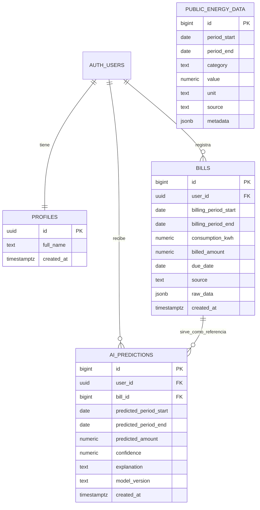

# Base de datos del proyecto de predicción de facturas de energía

## Objetivo

La base de datos almacena usuarios, facturas de energía, datos públicos utilizados por el modelo y predicciones generadas por la inteligencia artificial.

## Modelo de datos

## Tablas

### `profiles`

Complementa a `auth.users` de Supabase Auth. No guarda contraseñas. La autenticación y el almacenamiento seguro de contraseñas quedan a cargo de Supabase Auth.

### `bills`

Guarda el historial de facturas de cada usuario, incluyendo periodo, consumo, valor cobrado, fecha límite y fuente de los datos.

### `ai_predictions`

Guarda la estimación futura realizada por la IA, el rango de fechas, el valor previsto, la confianza, una explicación y la versión del modelo utilizado.

### `public_energy_data`

Almacena datos públicos, como tarifas, categorías o valores energéticos usados para construir las predicciones. Se mantiene separada de la información privada de los usuarios.

## Seguridad

- Cada tabla privada usa Row Level Security.
- Un usuario solo puede consultar sus propios perfiles, facturas y predicciones.
- Las contraseñas no se almacenan en tablas creadas por el proyecto.
- Las consultas del backend deben usar parámetros, nunca concatenar texto recibido del usuario.
- La clave privada de Supabase solo debe estar en el backend de Python.
- La clave pública puede utilizarse en el cliente únicamente junto con políticas RLS correctas.

## Cómo ejecutarlo

1. Crear un proyecto en Supabase.
2. Abrir **SQL Editor**.
3. Copiar el contenido de `supabase_schema.sql`.
4. Ejecutarlo con **Run**.
5. Revisar las tablas en **Table Editor**.
6. Activar el método de inicio de sesión que utilizará el proyecto en **Authentication**.

## Justificación técnica para la presentación

Se utiliza un modelo relacional porque una factura pertenece a un usuario y una predicción puede estar relacionada con una factura anterior. Los importes se almacenan como `numeric` para evitar errores de precisión monetaria. Los campos `jsonb` permiten conservar datos adicionales sin romper la estructura principal. La seguridad RLS limita el acceso según el usuario autenticado.

## Próxima fase

La conexión con Python se realizará después mediante una API. Esa API leerá las facturas, ejecutará el modelo de IA y guardará las predicciones en `ai_predictions`.